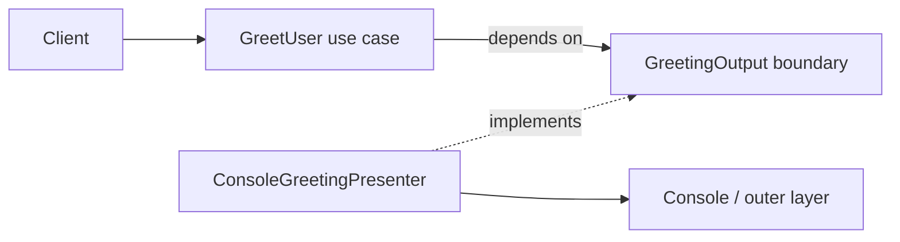

# Clean Architecture

The use case depends on an output boundary (`GreetingOutput`), not on an
external delivery mechanism. The domain value is independent of I/O, and the
console presenter is an outer adapter. Dependencies point toward the policy
core; framework and delivery choices can change at the edge.

**Good fit:** applications with policy that should remain stable as frameworks,
storage, or delivery mechanisms change. **Trade-off:** boundaries and mapping
types add ceremony; keep the architecture proportional to the problem.

Examples: [`GreetUser.java`](src/main/java/com/absolutebonkers/architecture/clean/GreetUser.java),
[`GreetingOutput.java`](src/main/java/com/absolutebonkers/architecture/clean/GreetingOutput.java),
[`ConsoleGreetingPresenter.java`](src/main/java/com/absolutebonkers/architecture/clean/ConsoleGreetingPresenter.java) ·
Test: [`GreetUserTest.java`](src/test/java/com/absolutebonkers/architecture/clean/GreetUserTest.java).

Run with `./gradlew :clean-architecture:test` from the repository root.
