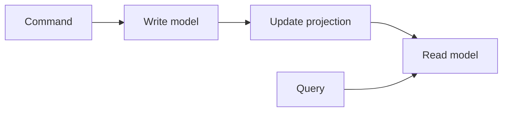

# Command Query Responsibility Segregation (CQRS)

Commands change state through the write side; queries read a separate view.
The tiny example keeps the two interfaces and responsibilities explicit while
sharing an in-memory store for simplicity. Production CQRS may use separate
models or stores and must handle synchronization and eventual consistency.

**Good fit:** read and write workloads or models have meaningfully different
needs. **Trade-off:** projections must stay synchronized; separate stores can
introduce lag and operational complexity. CQRS does not require event sourcing.

Martin Fowler's [CQRS overview](https://martinfowler.com/bliki/CQRS.html)
emphasizes that separate models can add risky complexity and are worthwhile
only when the problem benefits from them.

Example: [`TaskBoard.java`](src/main/java/com/absolutebonkers/architecture/cqrs/TaskBoard.java) ·
Test: [`TaskBoardTest.java`](src/test/java/com/absolutebonkers/architecture/cqrs/TaskBoardTest.java).

Run with `./gradlew :cqrs:test` from the repository root.
