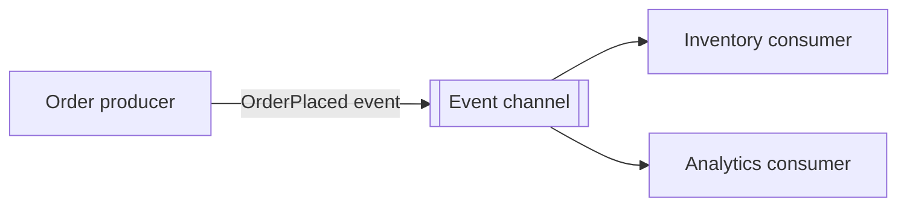

# Event-Driven Architecture (EDA)

The order producer emits an `OrderPlaced` fact without calling inventory
directly. Inventory and analytics subscribe independently and react to that
event. This tiny synchronous in-memory event bus is for illustrating
decoupling—not durable delivery, ordering, or broker guarantees.

**Good fit:** producers and consumers should evolve independently or one event
should trigger multiple reactions. **Trade-off:** asynchronous behavior makes
ordering, retries, duplicate delivery, observability, and eventual consistency
explicit design concerns.

Examples: [`OrderProducer.java`](src/main/java/com/absolutebonkers/architecture/eda/OrderProducer.java),
[`EventBus.java`](src/main/java/com/absolutebonkers/architecture/eda/EventBus.java) ·
Test: [`EventBusTest.java`](src/test/java/com/absolutebonkers/architecture/eda/EventBusTest.java).

Run with `./gradlew :event-driven:test` from the repository root.
