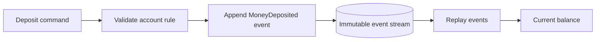

# Event Sourcing

The event stream is the source of truth: `AccountOpened` and `MoneyDeposited`
are appended as immutable facts, and the account balance is rebuilt by replay.
This in-memory stream omits persistence, concurrency control, snapshots, and
schema evolution, which real event stores must address.

**Good fit:** an auditable history and the ability to rebuild projections are
valuable domain requirements. **Trade-off:** event schemas, replay cost,
concurrency, snapshots, and compensating actions require careful design.
Event sourcing is not simply logging every method call.

Example: [`BankAccount.java`](src/main/java/com/absolutebonkers/architecture/eventsourcing/BankAccount.java) ·
Test: [`BankAccountTest.java`](src/test/java/com/absolutebonkers/architecture/eventsourcing/BankAccountTest.java).

Run with `./gradlew :event-sourcing:test` from the repository root.
