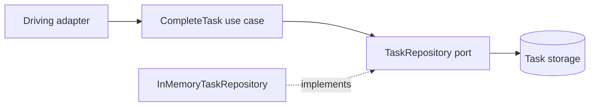

# Hexagonal Architecture (Ports & Adapters)

The application core defines a `TaskRepository` port. A use case depends on
that port, while the in-memory repository is a replaceable adapter. The core
does not need to know whether a future adapter uses SQL, a file, or a remote
service.

**Good fit:** business rules need to remain testable and independent of
frameworks, databases, or delivery mechanisms. **Trade-off:** explicit ports
and adapters add structure; avoid creating interfaces for details that do not
need to vary.

Examples: [`CompleteTask.java`](src/main/java/com/absolutebonkers/architecture/hexagonal/CompleteTask.java),
[`TaskRepository.java`](src/main/java/com/absolutebonkers/architecture/hexagonal/TaskRepository.java),
[`InMemoryTaskRepository.java`](src/main/java/com/absolutebonkers/architecture/hexagonal/InMemoryTaskRepository.java) ·
Test: [`CompleteTaskTest.java`](src/test/java/com/absolutebonkers/architecture/hexagonal/CompleteTaskTest.java).

Run with `./gradlew :hexagonal:test` from the repository root.
