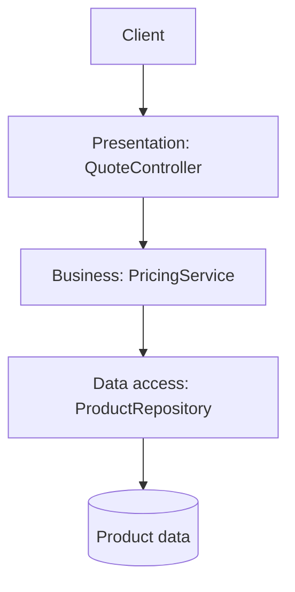

# Layered (N-Tier) Architecture

The request follows a clear direction: controller → service → repository.
Presentation handles the request, business logic calculates the price, and
data access supplies the product. This example uses in-process layers; N-tier
deployment can place layers on separate processes or machines.

**Good fit:** CRUD-oriented applications with clear presentation, business,
and data-access responsibilities. **Trade-off:** strict layer traversal can
add pass-through code or make cross-cutting changes touch many layers.

Examples: [`QuoteController.java`](src/main/java/com/absolutebonkers/architecture/layered/QuoteController.java),
[`PricingService.java`](src/main/java/com/absolutebonkers/architecture/layered/PricingService.java),
[`ProductRepository.java`](src/main/java/com/absolutebonkers/architecture/layered/ProductRepository.java) ·
Test: [`LayeredQuoteTest.java`](src/test/java/com/absolutebonkers/architecture/layered/LayeredQuoteTest.java).

Run with `./gradlew :layered:test` from the repository root.
