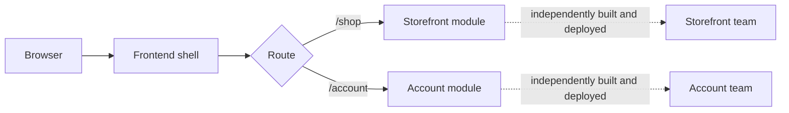

# Micro-Frontends

The shell selects a feature by route and asks its module to render into a
shared host contract. Independently owned frontend bundles can implement that
contract and be deployed separately. Here, Java components stand in for those
bundles so the composition idea can be tested without a browser or JavaScript
build system.

**Good fit:** multiple teams need independent ownership and release cycles for
large frontend areas. **Trade-off:** integration contracts, shared dependencies,
consistent UX, performance, and accessibility become harder to coordinate.
Avoid splitting a small frontend without a real organizational or delivery need.

Examples: [`FrontendShell.java`](src/main/java/com/absolutebonkers/architecture/microfrontends/FrontendShell.java),
[`FrontendModule.java`](src/main/java/com/absolutebonkers/architecture/microfrontends/FrontendModule.java),
[`StorefrontModule.java`](src/main/java/com/absolutebonkers/architecture/microfrontends/StorefrontModule.java),
[`AccountModule.java`](src/main/java/com/absolutebonkers/architecture/microfrontends/AccountModule.java) ·
Test: [`FrontendShellTest.java`](src/test/java/com/absolutebonkers/architecture/microfrontends/FrontendShellTest.java).

Run with `./gradlew :micro-frontends:test` from the repository root.
