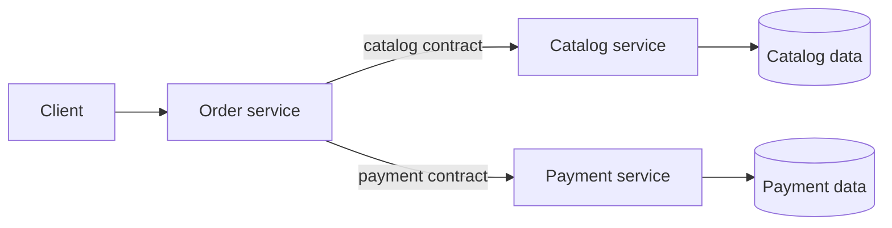

# Microservices Architecture

An order service coordinates independently modeled catalog and payment
services through explicit client contracts. The example substitutes local
implementations for network calls: real microservices add deployment,
serialization, latency, retries, and partial-failure concerns that an
in-process test cannot demonstrate.

**Good fit:** independently deployable capabilities with clear ownership and
operational maturity. **Trade-off:** network failures, observability, data
consistency, and deployment coordination become part of the design. Avoid
splitting a monolith into services before boundaries and operational needs
justify the added cost.

Example: [`OrderService.java`](src/main/java/com/absolutebonkers/architecture/microservices/OrderService.java) ·
Test: [`OrderServiceTest.java`](src/test/java/com/absolutebonkers/architecture/microservices/OrderServiceTest.java).

Run with `./gradlew :microservices:test` from the repository root.
