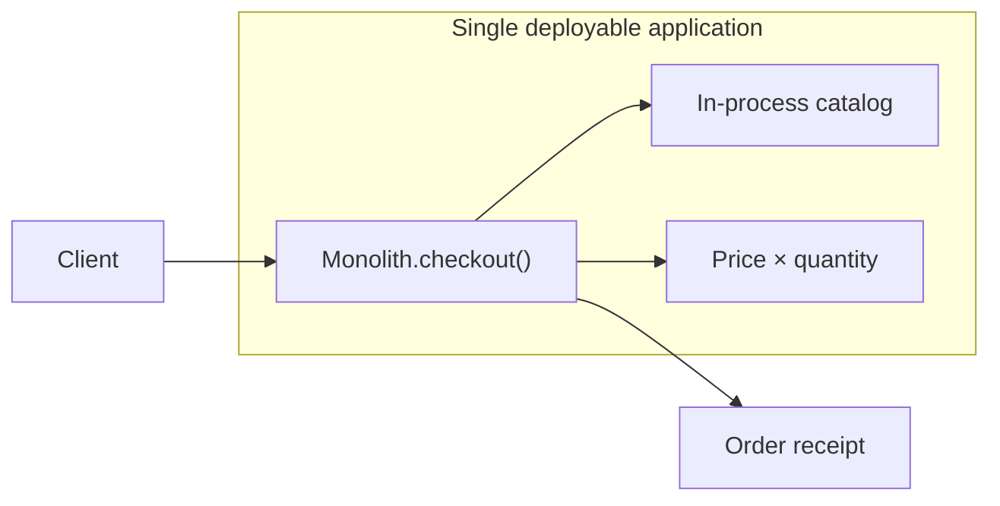

# Monolithic Architecture

One application coordinates a complete order workflow. Catalog, pricing, and
checkout are separate parts of the same deployable and call each other directly
in-process. This keeps local calls simple, while also making the application a
single deployment and scaling unit.

**Good fit:** a small product or a team that benefits from one straightforward
deployment. **Trade-off:** parts cannot be deployed or scaled independently;
changes share a release boundary.

Example: [`Monolith.java`](src/main/java/com/absolutebonkers/architecture/monolithic/Monolith.java) ·
Test: [`MonolithTest.java`](src/test/java/com/absolutebonkers/architecture/monolithic/MonolithTest.java).

Run with `./gradlew :monolithic:test` from the repository root.
