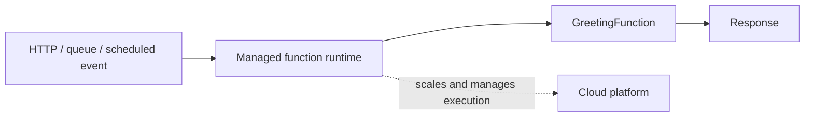

# Serverless Architecture

`GreetingFunction` is a stateless request handler with an explicit request and
response contract. A cloud function runtime can invoke the handler; the test
calls it directly, without pretending to emulate cold starts, scaling,
permissions, or a provider's event envelope.

**Good fit:** event-triggered, stateless work with variable demand and a
managed execution platform. **Trade-off:** cold starts, execution limits,
provider coupling, observability, and distributed state still need design.
Serverless does not mean there are no servers or operational concerns.

Example: [`GreetingFunction.java`](src/main/java/com/absolutebonkers/architecture/serverless/GreetingFunction.java) ·
Test: [`GreetingFunctionTest.java`](src/test/java/com/absolutebonkers/architecture/serverless/GreetingFunctionTest.java).

Run with `./gradlew :serverless:test` from the repository root.
