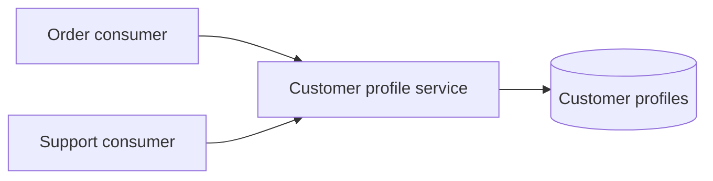

# Service-Oriented Architecture (SOA)

The shared customer-profile service exposes a business capability through a
stable contract. Both the order and support consumers reuse it instead of
duplicating profile lookup rules. This illustrates service reuse and contracts;
it does not prescribe a particular transport or enterprise service bus.

**Good fit:** shared business capabilities used by multiple systems, especially
when service contracts and governance matter. **Trade-off:** shared services
can become bottlenecks or tightly coupled dependencies if contracts, ownership,
and versioning are neglected.

Examples: [`CustomerProfileService.java`](src/main/java/com/absolutebonkers/architecture/soa/CustomerProfileService.java),
[`OrderDesk.java`](src/main/java/com/absolutebonkers/architecture/soa/OrderDesk.java),
[`SupportDesk.java`](src/main/java/com/absolutebonkers/architecture/soa/SupportDesk.java) ·
Test: [`SharedServiceTest.java`](src/test/java/com/absolutebonkers/architecture/soa/SharedServiceTest.java).

Run with `./gradlew :soa:test` from the repository root.
